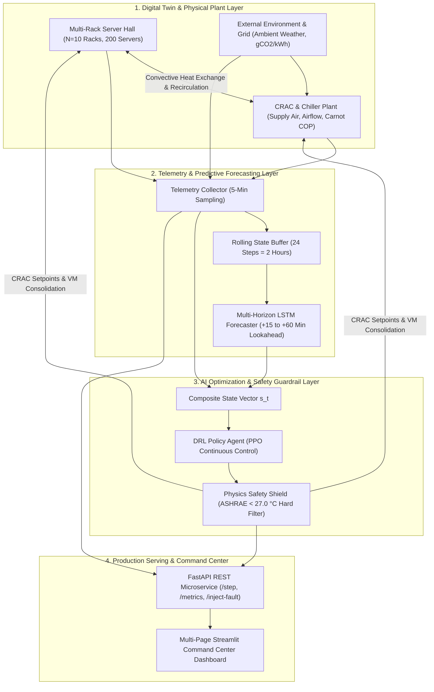

# System Architecture & Mathematical Formulation

## 1. End-to-End Architecture

## 2. Markov Decision Process (MDP) Equations

- **Power Usage Effectiveness:** $\text{PUE}_t = \frac{P^{\text{IT}}_t + P^{\text{cool}}_t}{P^{\text{IT}}_t}$
- **Fan Affinity Law:** $P_{\text{fan}}(\dot{m}_t) = P_{\text{fan,max}} \cdot \dot{m}_t^3 + P_{\text{pump,base}}$
- **Multi-Objective Reward:**
  $$R_t = -\left( w_1 \frac{P^{\text{total}}_t}{P^{\text{max}}} + w_2 \frac{P^{\text{total}}_t \cdot C^{\text{grid}}_t}{E^{\text{carbon}}_{\text{norm}}} + w_3 \sum_{i=1}^N \left[\max(0, T^{\text{in}}_{i,t+1} - 27.0)^2 + 50\,\mathbb{I}(T^{\text{in}}_{i,t+1} \ge 30.0)\right] + w_4 \|a_t - a_{t-1}\|_2^2 \right)$$
